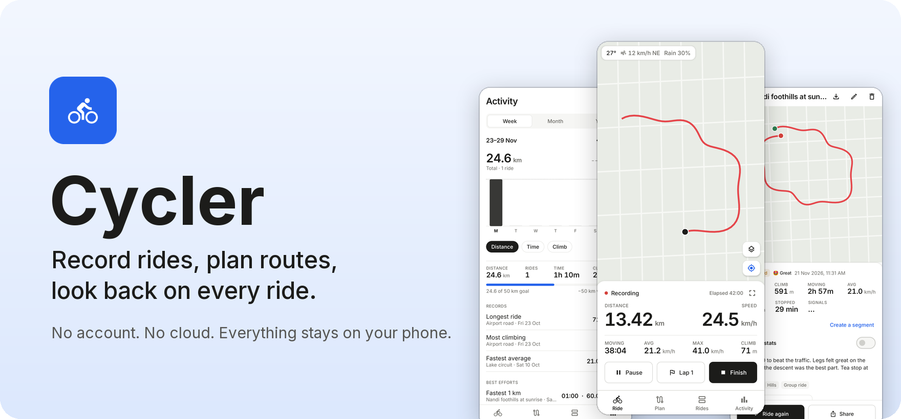
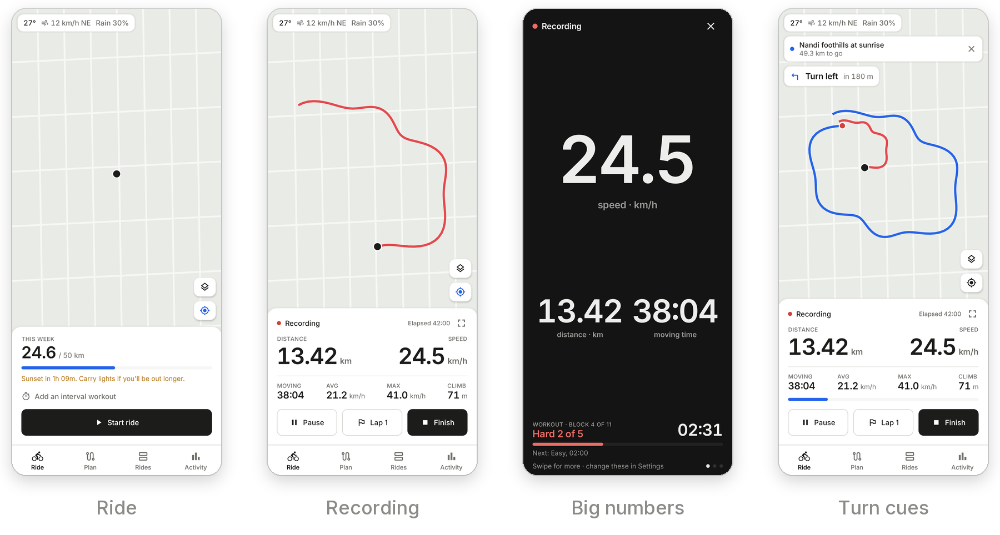
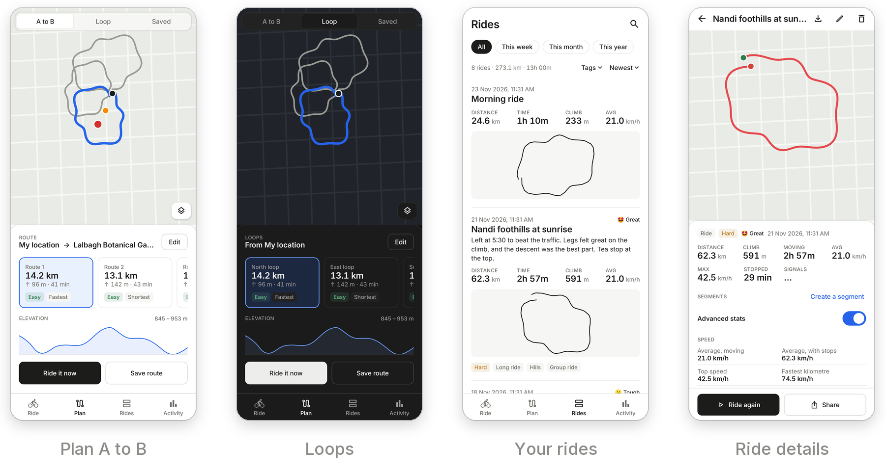
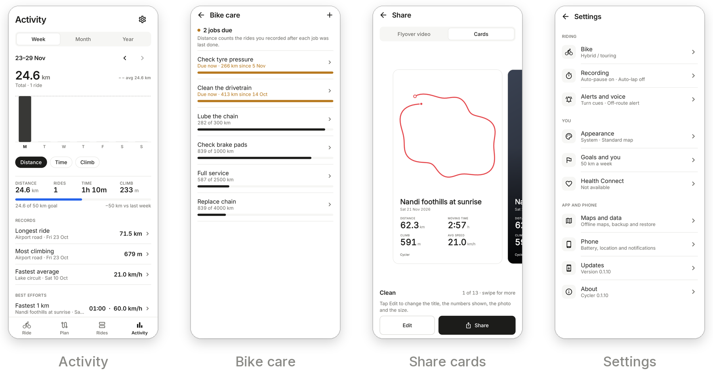
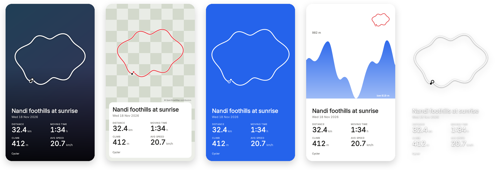
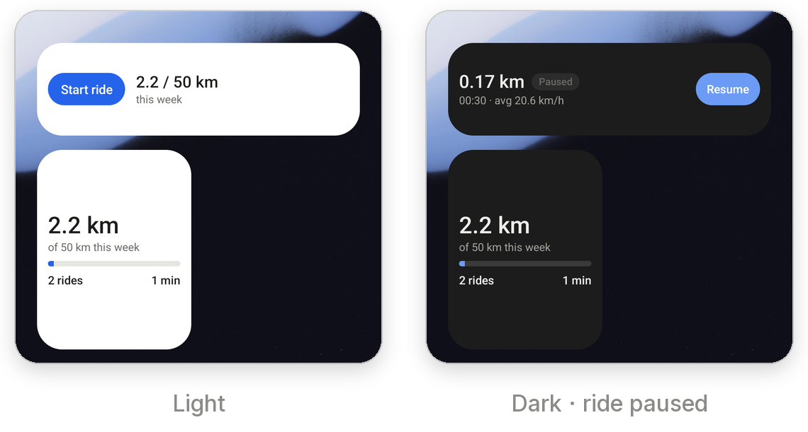
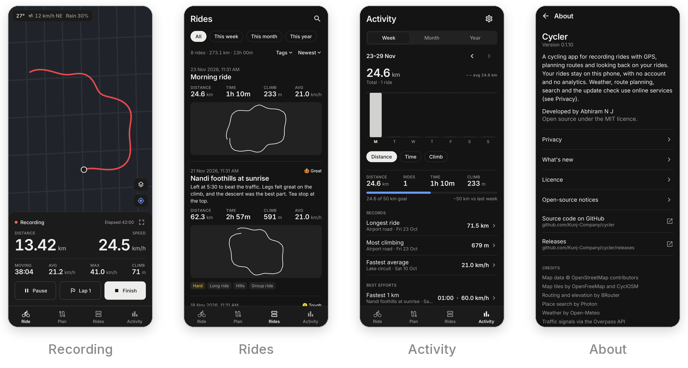

<p align="center">
  
</p>

<p align="center">
  <a href="https://github.com/Kunj-Company/cycler/releases"></a>
  
  
  <a href="LICENSE"></a>
</p>

<p align="center">
  <b>A personal cycling app for Android.</b><br>
  Record rides with the screen off, plan routes and loops, and look back on every ride.<br>
  No account, no ads. Your rides stay on your phone.<br>
  <a href="https://cycler.kunj.company/">cycler.kunj.company</a>
</p>

<p align="center">
  <a href="https://github.com/Kunj-Company/cycler/releases"><b>⬇&nbsp; Download the latest APK</b></a>
</p>

---

## Record

Live map with weather, distance, speed, moving time, climb and auto-pause. Recording keeps
going with the screen off. Laps, interval workouts with spoken prompts, a big-number screen
you lay out yourself, and turn-by-turn cues when you follow a route.

<p align="center"></p>

## Plan, then look back

Plan A-to-B routes or round-trip loops from 5 to 200 km, with climb, time and an elevation
profile. Every finished ride gets its own page: map, stats, laps, photos, notes, tags and
optional advanced stats.

<p align="center"></p>

## Activity, bike care and sharing

Weekly, monthly and yearly charts with records and best efforts. Bike care reminds you to
lube the chain or service the bike by kilometres or days. Share a ride as a 3D flyover video
or a card in 13 styles.

<p align="center"></p>

<p align="center"></p>

## Home-screen widgets

**Ride** starts, pauses and laps a ride from the home screen and shows live numbers.
**This week** tracks your weekly goal, **Last ride** sums up your latest ride, and
**Riding stats** shows the last seven days.

<p align="center"></p>

## Dark mode, everywhere

<p align="center"></p>

<details>
<summary><b>Everything Cycler does</b></summary>

- **Ride**: live map, start, pause and finish. Keeps recording with the screen off.
  Distance, speed, moving time, average, max and climb. Auto-pause when you stop.
  Wind, temperature and rain chance on the map. Weekly goal progress and a sunset
  warning before you start. Switch map style from the map itself.
- **Follow a route**: ride any saved or planned route, with distance to go and a vibration
  if you leave it. The next turn and its distance, a nudge before each turn, climbs coming
  up and traffic signals on the map.
- **Laps and workouts**: a Lap button and optional auto-lap; interval workouts with
  on-screen, vibration and spoken prompts for each block.
- **Ride screen**: swipeable pages of big numbers, with the fields you choose.
- **Plan → A to B**: start and end fields, optional stops, search or long-press the map.
  Up to three routes with distance, climb, time, difficulty and an elevation profile.
- **Plan → Loop**: pick a distance (5–200 km) and get round trips in four directions.
- **Plan → Saved**: "Suggest routes near me" (short, medium and long loops), your saved
  routes, and GPX import.
- **Rides**: a feed of finished rides with stats, route shape, photos, how it felt, notes
  and tags. Filter by week, month or year, sort, search and filter by tag.
- **After a ride**: a save page for the title, how it felt, notes, tags, photos and videos.
  The same page edits a ride later.
- **Ride page**: photos and videos, laps, stops, stopped time, signal count, heart rate,
  and advanced speed, time, stop, elevation and effort detail.
- **Activity**: one chart by week, month or year for distance, time or climb, with totals,
  records and best efforts. All rides on one map.
- **Segments**: cut a stretch from any ride; every ride over it is timed and ranked.
- **Share**: an animated 3D flyover video of the ride, or a card in 13 swipeable styles
  with editable title, numbers, photo and size.
- **Bike care**: jobs with kilometre or day intervals, notes and history. Mark one done
  today, on an earlier date or after a past ride.
- **Widgets**: Ride, This week, Last ride and Riding stats.
- **Export**: FIT, TCX and GPX files, to share with apps that import them.
- **Health Connect**: heart rate and weight that other apps put in Health Connect. Read only.
- **Offline maps**: save the map around you for rides without signal.
- **Backup and restore**: rides, routes, photos, segments, bike care and settings in one zip.
- **First launch**: a short setup for location, background recording, bike type and goal.

</details>

## Install

1. Download `Cycler-<version>.apk` from [Releases](https://github.com/Kunj-Company/cycler/releases)
   on an Android 8.0+ phone and open it. Allow installing from your browser or files app
   when asked.
2. Cycler does not check for updates. Download a newer release from the same page and install it over the old one; your rides are kept.

Release builds are signed with Cycler's release key. Certificate SHA-256:

    fc:11:15:05:4d:d6:ec:d2:21:b7:3c:a6:a1:52:28:dc:0b:45:a8:1b:63:fc:2b:9b:bf:30:fe:b9:0f:f7:d9:00

Keep a backup now and then: **Settings → Maps and data → Back up everything**.

## Privacy

Rides, photos and settings stay in the app's own storage on your phone. There is no
account and there are no ads. Only these requests leave the phone:

| What | Sent to | When | What is sent |
|---|---|---|---|
| Map tiles | OpenFreeMap, CyclOSM | Whenever a map is shown or saved for offline use | The tiles you view, so the provider sees the area |
| Weather | Open-Meteo | Whenever the app has a position, at most every 15 minutes | Position rounded to about 100 m (3 decimals) |
| Route planning | BRouter (brouter.de) | When you plan a route or loop, or ask for suggestions | The waypoints (6 decimals); for a loop, your current position is the start |
| Place search | Photon (photon.komoot.io) | When you search | The text you type, and your position rounded to about 1 km (2 decimals) |
| Traffic signals | Overpass API | When you open or follow a ride or route | A bounding box around the route |
| Usage stats | Cycler's stats server (Cloudflare) | Daily check; each finished week is sent once, if stats are on | Counts, km totals and ~11 km start/end areas; see below |

**Anonymous usage stats** are on by default, with a one-time notice on first launch. Once a
week Cycler sends counts (days the app was opened, rides, kilometres, features used) under a
random stats ID, and separately, with no ID, the ~11 km squares where saved rides started and
ended. No routes, exact positions, search text, ride details or device IDs. The server does
not store your IP address. Turn it off in **Settings → Privacy**; to delete what was sent,
email the stats ID shown there to hellokunjcompany@gmail.com. Every field is listed in
[docs/ANALYTICS.md](docs/ANALYTICS.md).

Apart from the stats server, these are free community servers with no API keys. Maps, planning and weather need
internet; recording does not. A backup is a zip file you save yourself. Photos in it keep
their original metadata, including where they were taken. Android cloud backup is off.
The same list is in the app under **About → Privacy**; the full policy is in
[docs/PRIVACY.md](https://github.com/Kunj-Company/cycler/blob/main/docs/PRIVACY.md).

## Build from source

Needs JDK 17 and the Android SDK (platform 36, build-tools 35/36).

```sh
./gradlew assembleDebug          # debug APK
./gradlew testDebugUnitTest      # unit tests and screenshot renders
```

Or open the folder in Android Studio and press Run.

Helpers in [`scripts/`](scripts):

| Script | Does |
|---|---|
| `run-emulator.sh` | Starts the `cycler_api35` emulator and waits for it to boot |
| `install-debug.sh` | Builds, installs and opens the debug APK with location granted |
| `gps-ride.sh [min] [km/h]` | Feeds the emulator a moving GPS track, so a ride can be recorded |

### Stats server

The server that receives usage stats is a Cloudflare Worker with a D1 database, in
[`stats-server/`](stats-server). Setup and deploy steps are in
[`stats-server/README.md`](stats-server/README.md). Builds point at it through the Gradle
property `statsUrl`; leave it empty to build without stats.

### Tests and screenshots without a phone

`./gradlew testDebugUnitTest` checks the maths behind the numbers (distance, speed, GPS
jumps, off-route, stats, heights) and backup safety, and renders every screen, light and
dark, to `app/build/shots/` with made-up rides. The map is drawn as a sketch there; real
tiles only appear on a device. The screenshots in this README come from those renders and
from an emulator.

## Release builds

Release builds are shrunk with R8 and signed with an upload key kept outside the repo.
Without that key the project still builds; the release APK is just left unsigned.

One-time setup (the key and its password never go into Git):

1. Create the key, outside the repo:

   ```sh
   mkdir -p ~/keystores && chmod 700 ~/keystores
   keytool -genkeypair -v -keystore ~/keystores/cycler-upload.jks -storetype PKCS12 \
     -alias cycler -keyalg RSA -keysize 2048 -validity 10000
   ```

2. Copy `keystore.properties.example` to `keystore.properties` (git-ignored), fill in the
   path and password, then `chmod 600 keystore.properties`.
3. Back up `cycler-upload.jks` and its password somewhere safe, away from this computer.
   Losing either means no more updates under this signature: phones with Cycler
   installed would have to uninstall it, and lose their data, to take a new build.

Build and check:

```sh
./gradlew assembleRelease bundleRelease
$ANDROID_HOME/build-tools/36.0.0/apksigner verify --print-certs \
  app/build/outputs/apk/release/app-release.apk
```

- APK: `app/build/outputs/apk/release/app-release.apk` (for GitHub releases)
- Bundle: `app/build/outputs/bundle/release/app-release.aab` (for Google Play)
- Keep `app/build/outputs/mapping/release/mapping.txt` from each release, to decode
  crash stack traces from that version.

Updates install over the previous version, keeping its data, only when they are signed
with the same key and have a higher `versionCode`. A debug build cannot be installed over
a release build or the other way round. To move a phone from one to the other, back up in
the app, uninstall, install, and restore.

If Cycler goes on Google Play, enrol in Play App Signing and register this key as the
upload key.

## Project layout

| Path | What's there |
|---|---|
| `data/` | Models, geometry, JSON file storage, GPX, heights above sea level |
| `data/Export.kt` | FIT and TCX writers |
| `health/Health.kt` | Health Connect reads |
| `net/` | BRouter, Photon, weather and traffic signals |
| `share/` | Share cards, the flyover renderer and the MP4 encoder |
| `track/TrackingService.kt` | Foreground GPS recording, auto-pause, off-route alerts |
| `ui/` | Theme, components, screens and the map wrapper |
| `widget/` | The four home-screen widgets |
| `MainActivity.kt` | App shell and planning logic |

**Design:** neutral surfaces, hairline borders, ink-coloured buttons, one blue accent and
Inter type. Tokens live in `ui/Theme.kt`; shared pieces (buttons, segmented control, sheet,
metrics, charts) in `ui/Common.kt`.

**Versions:** numbered 0.1.N and tagged `v0.1.N`. Commits follow Conventional Commits, one
topic per commit. [CHANGELOG.md](CHANGELOG.md) lists what each version added.

## Licence

MIT, see [LICENSE](LICENSE). Developed by Abhiram N J. Libraries, the Inter font and map
data keep their own licences, listed in [THIRD_PARTY_NOTICES.md](THIRD_PARTY_NOTICES.md).
Map data © OpenStreetMap contributors.
